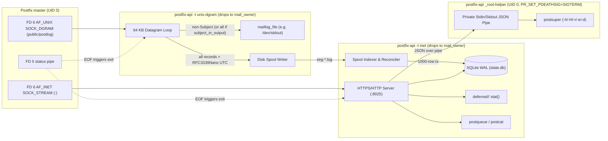

# `postfix-api` — Service Development Specification

**Date:** 2026-11-19  
**Author:** Andrey Martynyuk  
**Status:** Approved for Development  
**Module Path:** `github.com/PretorianX/postfix-http-api`  
**Target Toolchain & Runtime:** Go `1.27.4` (`CGO_ENABLED=0`, `linux/amd64` and `linux/arm64`, glibc & musl compatible)  
**Target Postfix & OS Matrix:** Postfix `>= 3.5`; verified target platforms: Debian 12 (Bookworm), Alpine 3.24, Postfix `3.11.7` (source build), and `boky/postfix:v4.4.0` drop-in container image.

---

## Table of Contents

1. [Document Metadata, Context & Architecture Decisions](#1-document-metadata-context--architecture-decisions)
2. [System & Package Architecture](#2-system--package-architecture)
3. [Master Child Protocol Specification (`internal/masterproto`)](#3-master-child-protocol-specification-internalmasterproto)
4. [Configuration Specification (`internal/config`)](#4-configuration-specification-internalconfig)
5. [Log Receiver & Disk Spool Specification (`internal/logreceiver`, `internal/spool`)](#5-log-receiver--disk-spool-specification-internallogreceiver-internalspool)
6. [Log Parser, SQLite Store & Indexer Specification (`internal/parser`, `internal/store`, `internal/indexer`)](#6-log-parser-sqlite-store--indexer-specification-internalparser-internalstore-internalindexer)
7. [Root Helper & Queue Commands Specification (`internal/postfixcmd`)](#7-root-helper--queue-commands-specification-internalpostfixcmd)
8. [HTTP API Specification (`internal/api`)](#8-http-api-specification-internalapi)
9. [CLI & Installer Specification (`internal/installer`, `cmd/postfix-api`)](#9-cli--installer-specification-internalinstaller-cmdpostfix-api)
10. [`boky/postfix:v4.4.0` Drop-In Container Image & CI/CD Specification](#10-bokypostfixv440-drop-in-container-image--cicd-specification)
11. [Verification & Test Specification](#11-verification--test-specification)
12. [Implementation Action Plan & Next Steps](#12-implementation-action-plan--next-steps)

---

## 1. Document Metadata, Context & Architecture Decisions

### 1.1 Business Context & Problem Statement

Postfix exposes only messages currently sitting in the mail queue (`postqueue`). Once a message is delivered, bounced, expired, or deleted, Postfix removes the queue file and leaves delivery outcomes solely as unstructured text lines in its log stream. Operators and upstream mail-sending services cannot query Postfix for the lifecycle of a specific message ("what happened to this email?"), its subject, per-recipient attempts, DSN codes, final status, or next deferred retry timestamp, nor can they manage the queue over an authenticated HTTP API.

`postfix-api` turns any standard Postfix `>= 3.5` host or container into a self-contained mail observability and queue-control node with SendGrid-equivalent message, recipient, and event tracking plus full queue management over HTTPS/HTTP, packaged as a single static binary and a drop-in `boky/postfix:v4.4.0` container image.

### 1.2 Scope & Non-Goals

- **In Scope:**
  - Single static Linux binary `postfix-api` (`linux/amd64`, `linux/arm64`, `CGO_ENABLED=0`) covering one Postfix instance per installation.
  - All mail accepted into the Postfix queue (`smtpd` queue acceptance, `pickup` local submission, `cleanup`, `qmgr`, delivery agents, `bounce`, `postsuper`).
  - Embedded delivery state store, bounded disk spool, live queue inspection, queue actions (`hold`, `release`, `requeue`, `expire`, `delete`, `flush`), and event feed (`/v1/events`) for downstream synchronization.
  - Drop-in `boky/postfix:v4.4.0` Docker image compatible with `hide-mail` workloads.
- **Out of Scope:**
  - Pre-queue SMTP rejections (`5xx` during `RCPT TO`/`DATA` before queue ID assignment).
  - Open/click pixel tracking or message body modification.
  - Remote mutation of `main.cf`, `master.cf`, or lookup tables over HTTP.
  - Multi-instance aggregation inside a single `postfix-api` process (hosts with multiple Postfix instances run one installation per `config_directory`).

### 1.3 Hard Environmental & Legal Constraints

1. **Unmodified Postfix:** Postfix source and binaries remain untouched; integration uses only `master.cf`, `main.cf`, `postconf`, `postqueue`, `postsuper`, and `postcat`.
2. **Environment Scrubbing by `master`:** Postfix `master(8)` strips process environment variables (retaining only configured pass-through variables such as `GENERATION`, `MAIL_CONFIG`, `MAIL_LOGTAG`, `PATH`). Runtime settings must come from `<config_directory>/postfix-api.conf` and `postconf`, and Postfix binaries must be invoked by full path via `command_directory`.
3. **Privilege Split:** `postsuper` enforces `geteuid() == 0` (`src/postsuper/postsuper.c:1351`), whereas `postlogd` opens `maillog_file` as `root` and drops to `mail_owner` (`src/postlogd/postlogd.c:237`), and network-facing HTTP handlers must never run as `root`.
4. **Blocking Log Socket:** Postfix clients log to `public/postlog` via blocking `SOCK_DGRAM` calls (`src/util/msg_logger.c:150`). The kernel datagram queue (`net.unix.max_dgram_qlen`, e.g., `10` in container tests) fills rapidly if the receiver stalls or restarts slowly; a receiver that fails to report readiness to `master` incurs a 60-second `service_throttle_time` restart penalty.
5. **Log Record Constraints:** Postfix log records omit year, timezone, and sub-second precision. Furthermore, `cleanup` truncates `header_checks` `INFO` output at 200 bytes (`src/cleanup/cleanup_message.c:272`).
6. **Version Floor:** `postlog`/`maillog_file` requires Postfix `>= 3.4`; `postsuper -e` requires Postfix `>= 3.5`; `postqueue -j` `orig_address` appeared in Postfix `>= 3.11`. Minimum supported Postfix version is **`3.5`**.
7. **Clean-Room Licensing:** Postfix is licensed under IPL 1.0 / EPL 2.0. All `postfix-api` Go code is written clean-room against documented CLI/protocol behavior without copying Postfix source text.
8. **Requeue Identity:** `postsuper -r` assigns a brand-new queue ID with no log link from old queue ID to new queue ID (only `message-id` and `Subject` carry over on the new message).

### 1.4 Architectural Decisions (Context, Choice, Rationale & Alternatives)

Each decision below is adopted from the approved architecture design (`2026-11-18-postfix-api-design.md`) with implementation-level refinements so the rationale remains clear 6–12 months after initial delivery:

| # | Decision | Recommended Choice & Rationale | Rejected Alternatives |
|---|---|---|---|
| **D1** | Process Supervision | **Long-running Go services managed by Postfix `master.cf`**. Only choice where Postfix itself starts, monitors, reloads, and stops `postfix-api` with zero secondary supervisor on bare hosts and one binary to install. | `spawn(8)` per-request (refuses root & `mail_owner`, no persistent log receiver); external `systemd`/sidecar (not started by Postfix, breaks single-container drop-in); C daemon linked to Postfix internal libs (ABI breaks per Postfix release). |
| **D2** | Log Capture | **Go log receiver replacing `postlogd` on `master.cf` `postlog` line**. Captures every log record at emission time with UTC nanosecond precision, works directly with `maillog_file=/dev/stdout`, and keeps container log output identical to `postlogd` without needing `rsyslog`. Pre-design PoC on Debian Postfix 3.7.11 demonstrated 3–4 ms restarts across 3 `SIGKILL`s during 32,000 records with 0 lost records and 2.4 MB RSS. | Tail `maillog_file` written by `postlogd` (cannot use `/dev/stdout` without shifting container stdout dependency onto our daemon, loses sub-second timestamps and year); syslog daemon fan-out (absent from minimal containers). |
| **D3** | Buffering & Decoupling | **Append-only bounded disk spool written by receiver; separate API/indexer process reads spool**. Bounds receiver memory independently of SQLite latency or API load, survives indexer crashes without dropping mail flow, and bounds disk usage via oldest-segment eviction. | In-process SQLite writes inside receiver (blocks Postfix mail flow on DB locks/corruption); unbounded/bounded in-memory channel inside one process (bursts lose records or OOM). |
| **D4** | Subject Capture | **`header_checks` `INFO` rule (`/^Subject:/ INFO`)**. Zero impact on SMTP delivery path; failure loses only Subject metadata; receiver suppresses `: info: header Subject: ` from log output by default (`subject_in_output: false`) to protect PII in external log collectors. | Custom `milter` service (places Go binary in SMTP accept path and requires `milter_default_action`); immediate `postcat` on queue entry (loses fast deliveries before read completes). |
| **D5** | Queue Control | **Invoke `postqueue`, `postsuper`, and `postcat` via fixed argument lists + privileged `_root-helper`**. Uses Postfix's supported, version-stable administrative CLI while isolating `UID=0` (`postsuper`) behind a narrow pipe protocol. | Direct manipulation of internal `showq`/`flush` sockets and queue files (undocumented internal format, high queue corruption risk). |
| **D6** | Delivery State Store | **Embedded SQLite (WAL mode) via `modernc.org/sqlite` in `<state_dir>`**. Satisfies single-binary zero-external-dependency drop-in operation with `CGO_ENABLED=0` and supports single-writer batch transactions alongside concurrent HTTP readers. | External PostgreSQL/OpenSearch (breaks drop-in container model); live scan of spool on every HTTP query (prohibitive latency for recipient/message-id search). |

---

## 2. System & Package Architecture

### 2.1 Binary & Build Specification

- **Module Path:** `github.com/PretorianX/postfix-http-api` (per `go.mod`)
- **Dependencies (verified in `go.mod`):**
  - `go 1.27.4`
  - `gopkg.in/yaml.v3 v3.0.1`
  - `modernc.org/sqlite v1.37.0`
- **Build Artifact:** Single static ELF executable named `postfix-api`.
  - Build flags: `CGO_ENABLED=0 GOOS=linux GOARCH=amd64|arm64 go build -trimpath -ldflags="-s -w" -o postfix-api ./cmd/postfix-api`
  - Because `CGO_ENABLED=0` is enforced and pure-Go `os/user` resolves `/etc/passwd` and `/etc/group` directly, the identical binary executes on both `glibc` (Debian 12) and `musl` (Alpine 3.24) without dynamic linker dependencies.

### 2.2 Process Architecture & Privilege Boundaries



**Strict Privilege Lifecycle Rules:**

1. Both `master`-launched processes (`unix-dgram` and `inet`) start with `UID=0` (`master.cf` `priv = n` column `-` or `n` with unprivileged=`n`).
2. **While still `root`**, each process MUST:
   - Execute `postconf` to resolve Postfix directory and owner settings.
   - Read `<config_directory>/postfix-api.conf` (which is `0600` `root:root`).
   - *(Log Receiver only)*: Open `maillog_file` for write/append (`root` access needed for `/dev/stdout` or root-owned `/var/log/*`).
   - *(API Process only)*: Load `tls.cert_file` and `tls.key_file` bytes into memory (keys are typically `0600` `root:root`), verify non-loopback plaintext policy, mark FD 5 and FD 6 `O_CLOEXEC`, create two private OS pipes, and spawn `postfix-api _root-helper` retaining `UID=0`.
   - Ensure `<state_dir>` and `<state_dir>/spool` exist (`0750`) and recursively `chown` `<state_dir>` contents to `mail_owner` UID:GID so a prior root-invoked `install` or manual run never leaves files unreadable to `mail_owner`.
3. **Permanent Privilege Drop (before entering service loops):**
   - Look up `mail_owner` UID and primary GID via `os/user.Lookup`.
   - Drop supplementary groups and set GID/UID using `syscall.Setgroups([]int{gid})`, `syscall.Setgid(gid)`, `syscall.Setuid(uid)` (executed across all OS threads by Go's `AllThreadsSyscall` runtime support; additionally perform privilege drop before launching background goroutines).
   - Assert `os.Getuid() == uid && os.Geteuid() == uid && os.Getgid() == gid && os.Getegid() == gid`. If any assertion fails, log fatal error and exit immediately.
4. **Root Helper Isolation:**
   - `_root-helper` closes/never receives FD 5 and FD 6 (`O_CLOEXEC` enforced in parent prior to `fork/exec`).
   - `_root-helper` binds no network or Unix sockets, never parses HTTP, never touches SQLite, and exits immediately upon parent pipe EOF or `PR_SET_PDEATHSIG` (`SIGTERM`).

### 2.3 Repository Package Layout

```text
github.com/PretorianX/postfix-http-api
├── cmd/
│   └── postfix-api/
│       ├── main.go               # CLI subcommand & master-service entrypoint
│       └── ...
├── internal/
│   ├── masterproto/              # FD 5/6 handling, GENERATION, MASTER_STATUS, flag tolerance
│   ├── config/                   # YAML config schema, postconf probing, validation, defaults
│   ├── spool/                    # Segment rotation, eviction, gaps.count/lost.count, cursor reader
│   ├── logreceiver/              # maillog_file lifecycle, 64KB zero-alloc loop, subject filter
│   ├── parser/                   # Postfix daemon line parsers + RFC 2047 MIME decoder
│   ├── store/                    # modernc.org/sqlite WAL store, DDL, queries, retention
│   ├── indexer/                  # Batch spool consumer, postqueue -j reconciler, 2-miss closure
│   ├── postfixcmd/               # Queue ID validator, _root-helper pipe protocol, postqueue/postcat/stat
│   ├── api/                      # HTTP/TLS listener, Bearer auth/scopes, /v1/* handlers, audit log
│   └── installer/                # Idempotent 9-step install, uninstall, backup state, token gen
├── docker/
│   └── boky/                     # Drop-in Dockerfile + 99-postfix-api.sh + supervisord patch
├── test/
│   └── integration/              # Real Docker Postfix matrix & resilience test suite
├── .github/
│   └── workflows/
│       ├── ci.yml                # Go unit/race/build + Docker integration test matrix
│       └── docker-publish.yml    # Multi-arch GHCR image publish + release binaries
├── docs/
│   └── SPEC.md                   # This specification
├── go.mod
└── go.sum
```

---

## 3. Master Child Protocol Specification (`internal/masterproto`)

Postfix `master(8)` spawns child services directly via `execve` without a shell and coordinates readiness and shutdown over two inherited file descriptors (`src/master/master_proto.h`, `src/master/master_spawn.c`, `src/master/single_server.c`).

### 3.1 Inherited File Descriptors & Environment

| Constant | Value | Meaning | Handling in `postfix-api` |
|---|---|---|---|
| `MasterStatusFD` | `5` | `MASTER_STATUS_FD` — bidirectional/write status pipe to `master` | Wrap in `*os.File` after marking `syscall.CloseOnExec(5)`. Write `MASTER_STATUS` frames; block in a goroutine calling `Read` to detect reload/stop. |
| `MasterListenFD` | `6` | `MASTER_LISTEN_FD` — pre-bound service socket (`AF_UNIX SOCK_DGRAM` or `AF_INET`/`AF_INET6 SOCK_STREAM`) | Wrap in `*os.File` after marking `syscall.CloseOnExec(6)`. Receiver reads datagrams directly; API passes to `net.FileListener`. Never `unlink` socket path on exit. |
| `GENERATION` | Env var | Octal ASCII `uint32` generation counter set by `master_spawn.c` | Parse with `strconv.ParseUint(os.Getenv("GENERATION"), 8, 32)`. **Must use base `8`**, never base `10` (e.g., `"10"` means generation `8`). |
| `MAIL_CONFIG` | Env var | Optional config directory passed by `master` (`-c` / multi-instance) | Forward to `postconf -c <MAIL_CONFIG>` when `MAIL_CONFIG` is non-empty. |

### 3.2 `MASTER_STATUS` Binary Frame Layout

Each status notification written to FD `5` MUST be an exact **12-byte native-endian** (`encoding/binary.NativeEndian`) record matching Postfix's C `struct MASTER_STATUS`:

```text
Offset  Size  Type     Field    Description
0       4     int32    pid      int32(os.Getpid())
4       4     uint32   gen      uint32 parsed from octal GENERATION env var
8       4     int32    avail    0 = MasterStatTaken, 1 = MasterStatAvail
```

- Encode into a stack-allocated `[12]byte` array and issue a single `syscall.Write(MasterStatusFD, frame[:])` (retrying on `syscall.EINTR`) so the 12-byte frame is written atomically.
- Define typed constants:
  - `MasterStatTaken int32 = 0`
  - `MasterStatAvail int32 = 1`

### 3.3 Startup Handshake & Shutdown Trigger

1. **Startup Handshake (Prevents 60s `service_throttle_time`):**
   - Complete initialization (config load, privilege drop, socket wrapper setup) so the service is genuinely ready to accept traffic on FD `6`.
   - Immediately send `MASTER_STATUS{pid, gen, avail: 0}` (`MasterStatTaken`), followed immediately by `MASTER_STATUS{pid, gen, avail: 1}` (`MasterStatAvail`).
   - **Why both:** Sending `taken` then `available` marks one completed readiness/service cycle inside `master`'s child tracker so a subsequent `SIGKILL` causes `master` to respawn immediately (~3–4 ms observed in PoC) rather than throttling for 60 seconds (`service_throttle_time`).
2. **Shutdown Trigger (`postfix reload` / `postfix stop`):**
   - Spawn a dedicated monitor goroutine performing a blocking read on FD `5` (`var buf [1]byte; _, err := statusFile.Read(buf[:])`).
   - On `postfix reload` or `postfix stop`, `master` closes its end of FD `5`. When `Read` returns `io.EOF` or any non-`EINTR` error, cancel the root `context.Context`.
   - **Receiver Shutdown Behavior:** Set a short non-blocking drain or immediate read deadline (e.g., 50 ms) on FD `6` to drain any datagrams already queued in the kernel socket buffer, flush `maillog_file` and current spool segment file (`Close()`), and exit `0`.
   - **API Shutdown Behavior:** Call `httpServer.Shutdown(ctx)` with a 5-second timeout, cancel the indexer loop so it exits cleanly after committing any active SQLite transaction, close SQLite DB, close `_root-helper` stdin pipe and `Wait()` up to 5 seconds (sending `SIGKILL` if stuck), and exit `0`.

### 3.4 Postfix `master` CLI Flag Tolerance

`master` passes service flags constructed from `master.cf` fields (`chroot`, `unpriv`, `wakeup`, `maxproc`, `verbose`, `-o`, `-c`, `-n`, etc.) before invoking the executable. Standard Go `flag.Parse()` aborts on unknown flags and MUST NOT be used for `master` invocations.

Implement a custom deterministic scanner `ParseMasterArgs(args []string) (MasterFlags, error)` in `internal/masterproto`:

- Recognize and extract:
  - `-t <val>` or `-t<val>` -> `Transport` (`"unix-dgram"` or `"inet"`)
  - `-n <val>` or `-n<val>` -> `ServiceName`
  - `-c <val>` or `-c<val>` (Wait: in Postfix daemons, `-c` takes no argument when signaling chroot, OR `postconf`/`postfix` uses `-c <dir>`; in `master_spawn.c`, `-c` is a standalone boolean flag meaning "chroot", while `-n`, `-t`, `-o`, `-s`, `-T`, `-f`, `-h` take a following argument if not attached!)
  - Value-taking Postfix daemon flags (`master_spawn.c` / `single_server.c`): `-t`, `-n`, `-o`, `-s`, `-T`, `-f`, `-h`. Consume the next arg when the flag is exact (`"-o"` consumes `"key=val"`), or treat attached value (`"-tinet"`) as single token.
  - Standalone boolean Postfix daemon flags: `-u`, `-c`, `-l`, `-z`, `-v`, `-d`, `-S`, `-r`, `-D`, `-Z`. Skip safely.
  - Any unrecognized `-<letter>` flag: tolerate without failing so future Postfix versions adding daemon flags never break startup.
- **Dispatch Rule in `cmd/postfix-api`:**
  - If `len(os.Args) >= 2` and `os.Args[1]` matches a CLI subcommand (`install`, `uninstall`, `token`, `_root-helper`, `version`, `help`, `--help`, `-h`), run that CLI subcommand.
  - Otherwise, invoke `ParseMasterArgs(os.Args[1:])`:
    - `Transport == "unix-dgram"` -> run Log Receiver service.
    - `Transport == "inet"` -> run HTTP API + Indexer service.
    - Missing or unsupported `-t` -> write usage error to stderr and exit code `2`.

---

## 4. Configuration Specification (`internal/config`)

### 4.1 File Path, Permissions & Format

- **Location:** `<config_directory>/postfix-api.conf` (typically `/etc/postfix/postfix-api.conf`), where `config_directory` is resolved via `postconf -h config_directory` (respecting `MAIL_CONFIG` if set).
- **Ownership & Permissions:** `root:root`, mode `0600`.
  - When running as `root` (prior to dropping privileges), `config.Load()` inspects `os.Stat(confPath)`. If `info.Mode().Perm()&0o077 != 0`, abort startup with an explicit security error instructing the operator to run `chmod 0600 <confPath>`.
- **Format Choice (P10 Recommendation):** **YAML** (`gopkg.in/yaml.v3`).
  - **Rationale:** Token authentication requires structured nested entries (`name`, `sha256`, `scopes: [read, write, content]`) paired with human-readable comments inside a root-only security file. YAML models nested lists cleanly, allows inline comments, and `gopkg.in/yaml.v3` is already in `go.mod` with zero CGO overhead.
  - **Alternatives Considered:**
    - *TOML:* Clean scalar typing, but `[[tokens]]` array-of-tables syntax is noisy for operators editing secrets by hand and adds an extra parser dependency.
    - *INI:* Lacks native list/object typing for `tokens` and `scopes`, forcing awkward `token.<name>.scopes = a,b` naming conventions.

### 4.2 Exact YAML Schema & Defaults

```yaml
# Optional directory for spool and SQLite state DB.
# Defaults to "<data_directory>/postfix-api" when empty.
state_dir: ""

spool:
  segment_size_bytes: 16777216    # 16 MiB
  max_total_bytes: 268435456      # 256 MiB

retention_duration: 168h          # 7 days after removal from queue
queue_sync_interval: 5m           # postqueue -j reconciliation interval
indexer_batch_size: 1000          # spool lines committed per SQLite transaction
subject_in_output: false          # keep Subject header_check lines out of maillog_file by default

tls:
  cert_file: ""                   # PEM certificate chain path
  key_file: ""                    # PEM private key path

allow_plaintext: false            # must be true to serve HTTP without TLS on non-loopback addrs

tokens:
  - name: "example-reader"
    sha256: "e3b0c44298fc1c149afbf4c8996fb92427ae41e4649b934ca495991b7852b855"
    scopes:
      - read
```

### 4.3 Parsing & Validation Rules

Decode YAML using `dec := yaml.NewDecoder(f); dec.KnownFields(true)` so unknown keys or misspelled fields (e.g., `allow_plain_text`) fail loudly on startup rather than silently defaulting.

| Field | Default | Validation Rule |
|---|---|---|
| `state_dir` | `<data_directory>/postfix-api` | Must resolve to an absolute path after default expansion. |
| `spool.segment_size_bytes` | `16777216` (16 MiB) | `>= 65536` (must accommodate one max 64 KB datagram line) and `<= spool.max_total_bytes`. |
| `spool.max_total_bytes` | `268435456` (256 MiB) | `>= spool.segment_size_bytes` (recommended `>= 2 * segment_size_bytes`). |
| `retention_duration` | `168h` (7 days) | Valid Go duration `> 0`. |
| `queue_sync_interval` | `5m` | Valid Go duration `>= 5s`. |
| `indexer_batch_size` | `1000` | Integer in `[1, 10000]`. |
| `subject_in_output` | `false` | Boolean. |
| `tls.cert_file`, `tls.key_file` | `""` | Both empty OR both non-empty readable files. Half-configured TLS is a hard startup error. |
| `allow_plaintext` | `false` | Boolean. Checked against FD `6` bind address when TLS is disabled. |
| `tokens` | `[]` | Empty list is valid (installer default; API rejects all requests with `401`). For each token: non-empty unique `name`, lowercase 64-hex-char `sha256` (`^[0-9a-fA-F]{64}$`, normalized to lowercase, decoded to `[32]byte`), non-empty `scopes` subset of `{"read", "write", "content"}`. |

- **Missing Config Behavior:**
  - **API process (`-t inet`):** Fail closed with non-zero exit if `postfix-api.conf` is missing or unreadable (never serve unconfigured).
  - **Log Receiver (`-t unix-dgram`):** If `postfix-api.conf` is malformed YAML, fail with error; if missing (`ENOENT`), log a warning to stderr and continue with safe defaults (`subject_in_output: false`, `<data_directory>/postfix-api`, 16 MiB / 256 MiB) so temporary config absence never blocks mail logging.

### 4.4 `postconf` Parameters Read at Startup

Because `master` strips `PATH`, resolve `postconf` by checking `exec.LookPath("postconf")` first, then falling back to `/usr/sbin/postconf`, `/usr/local/sbin/postconf`, `/sbin/postconf`. If `MAIL_CONFIG` env var is non-empty, pass `-c <MAIL_CONFIG>`.

Execute `postconf -h` (in a single invocation or validated key-value query `postconf command_directory queue_directory data_directory daemon_directory config_directory mail_owner maillog_file mail_version`) to read all 8 mandatory Postfix parameters:

| Parameter | Usage |
|---|---|
| `command_directory` | Full path prefix for `postqueue`, `postsuper`, `postcat`, and `postfix`. |
| `queue_directory` | Base directory for deferred queue file `stat()` (`<queue_directory>/deferred/...`). |
| `data_directory` | Parent directory for default `state_dir` (`<data_directory>/postfix-api`). |
| `daemon_directory` | Target install directory where `install` places `postfix-api`. |
| `config_directory` | Locates `postfix-api.conf`, `main.cf`, `master.cf`, and `postfix-api-header-checks`. |
| `mail_owner` | System username (typically `postfix`) whose UID/GID both daemons drop to. |
| `maillog_file` | Output path/device written by Log Receiver (e.g., `/dev/stdout` or `/var/log/postfix.log`). Must be non-empty. |
| `mail_version` | Postfix version string (e.g., `3.11.7`); validated `>= 3.5` (strip optional patch suffixes like `-20260101` or `~deb12u1` before numeric major.minor comparison). |

---

## 5. Log Receiver & Disk Spool Specification (`internal/logreceiver`, `internal/spool`)

### 5.1 Strict Architectural Invariants

1. **Zero Database Dependency:** `internal/logreceiver` and `internal/spool` MUST NOT import `database/sql`, `modernc.org/sqlite`, `internal/store`, `internal/parser`, or `internal/indexer`.
2. **No Blocking on Consumers:** The receiver never waits on, locks with, or communicates with the indexer or HTTP API.
3. **No Per-Record `fsync()`:** Spool writes use standard buffered/syscall `write(2)` without `fsync()` so disk sync latency never stalls Postfix's blocking `msg_logger` datagram socket.
4. **Log Output Availability Priority:** If writing to the disk spool fails (`ENOSPC`, `EIO`, `EROFS`), the receiver increments `lost.count` and **continues writing to `maillog_file`**.

### 5.2 Log Receiver Privilege & IO Lifecycle (`internal/logreceiver`)

1. Start as `root`. Probe `postconf`, load `postfix-api.conf`.
2. Validate `maillog_file != ""`. Open `maillog_file` as `root`:
   - Attempt `os.OpenFile(maillogFile, os.O_WRONLY|os.O_CREATE|os.O_APPEND, 0o600)`.
   - If `maillogFile` is a character device / fd symlink like `/dev/stdout` or `/dev/stderr` and `O_CREATE` fails with `EACCES`/`EROFS`/`EINVAL`, retry with `os.OpenFile(maillogFile, os.O_WRONLY|os.O_APPEND, 0)`.
3. Ensure `<state_dir>` (`0750`) and `<state_dir>/spool` (`0750`) exist and are owned by `mail_owner` UID:GID.
4. Initialize spool writer (`spool.NewWriter(...)`) while preparing directories, ensuring any existing `seg-*.log`, `gaps.count`, and `lost.count` files are owned by `mail_owner` UID:GID.
5. **Drop privileges permanently** to `mail_owner` (`Setgroups`, `Setgid`, `Setuid`).
6. Wrap FD `6` (`os.NewFile(6, "postlog")`, marked `O_CLOEXEC`), send `MASTER_STATUS` (`taken` then `avail`) on FD `5`, start FD `5` shutdown monitor goroutine.
7. Enter the **zero-allocation steady-state read loop**.

### 5.3 Zero-Allocation Steady-State Datagram Read Loop

Pre-allocate buffers once before entering the loop (verified by `testing.AllocsPerRun == 0`):

- `pktBuf [65536]byte` (max UDP/Unix datagram size)
- `outBuf := make([]byte, 0, 65537)` (datagram + `'\n'`)
- `spoolBuf := make([]byte, 0, 64+65537)` (timestamp + `' '` + datagram + `'\n'`)
- Constant byte marker: `var subjectMarker = []byte(": info: header Subject: ")`
- Fixed-width UTC RFC3339Nano layout: `const spoolTimeLayout = "2006-01-02T15:04:05.000000000Z"`

Per datagram iteration:

1. `n, err := sockFile.Read(pktBuf[:])`
   - On `err`: if `ctx.Err() != nil` or `errors.Is(err, os.ErrDeadlineExceeded)`, exit drain loop cleanly. On transient `EINTR`/`EAGAIN`, continue. On fatal socket error, exit non-zero so `master` restarts immediately.
2. Trim trailing `\r`, `\n`, and `\x00` bytes without allocation: `rec := bytes.TrimRight(pktBuf[:n], "\r\n\x00")`. If `len(rec) == 0`, skip.
3. Capture receive time once: `now := time.Now().UTC()`.
4. **Log output step:**
   - If `cfg.SubjectInOutput || !bytes.Contains(rec, subjectMarker)`:
     - `outBuf = append(append(outBuf[:0], rec...), '\n')`
     - Write `outBuf` to `maillog_file` as a single `write(2)` call (avoiding interleaved partial lines). On write error, increment an error counter / emit rate-limited warning to stderr, do not crash receiver unless fd is permanently broken.
5. **Spool append step (always executes, even when Subject is filtered from `maillog_file`):**
   - Format into `spoolBuf`:
     ```go
     spoolBuf = now.AppendFormat(spoolBuf[:0], spoolTimeLayout)
     spoolBuf = append(spoolBuf, ' ')
     spoolBuf = append(spoolBuf, rec...)
     spoolBuf = append(spoolBuf, '\n')
     ```
   - Call `spoolWriter.Append(spoolBuf)` (zero heap allocations in the hot path when no rotation/eviction occurs).

### 5.4 Disk Spool Format, Rotation, Eviction & Error Handling (`internal/spool`)

- **Directory:** `<state_dir>/spool/`
- **Segment Naming:** `seg-00000000000000000001.log` (`fmt.Sprintf("seg-%020d.log", seq)`), monotonically increasing `uint64` starting at `1`.
  - On startup, scan existing `seg-*.log` files in ascending sequence order. Open `maxSeq + 1` as the active write segment so a prior `SIGKILL` partial line never corrupts or glues onto subsequent records.
- **Line Format:** `<YYYY-MM-DDTHH:MM:SS.nnnnnnnnnZ> <raw-log-line>\n`
- **Segment Rotation:**
  - Before writing `line`, if `activeSegSize > 0 && activeSegSize + int64(len(line)) > cfg.Spool.SegmentSizeBytes`:
    - Close current active segment file.
    - Increment `seq`, open new `seg-<seq>.log` (`O_WRONLY|O_CREATE|O_EXCL|O_APPEND`, `0640`), reset `activeSegSize = 0`.
- **Eviction under `max_total_bytes`:**
  - Maintain tracked `totalBytes` across all `seg-*.log` files.
  - Because the indexer asynchronously deletes consumed segments, whenever `totalBytes + int64(len(line)) > cfg.Spool.MaxTotalBytes`, re-scan `<state_dir>/spool/` via `os.ReadDir` to compute accurate on-disk `totalBytes` and sorted segment list before evicting.
  - While `totalBytes + int64(len(line)) > cfg.Spool.MaxTotalBytes` and at least 1 closed segment precedes the active segment:
    - `os.Remove(oldestClosedSegment)` (ignore `os.ErrNotExist` if indexer just removed it).
    - If actually removed by receiver, subtract its size from `totalBytes` and increment **`gaps.count`**.
  - Edge case: if only the active segment exists and exceeds `max_total_bytes` (only possible when `segment_size_bytes == max_total_bytes`), allow finishing or rotating once then immediately deleting the closed prior segment on next write so disk stays bounded within `max_total_bytes + segment_size_bytes`.
- **Persistent Counters (`gaps.count` and `lost.count`):**
  - Stored in `<state_dir>/spool/gaps.count` and `<state_dir>/spool/lost.count`.
  - Pre-created on writer initialization as fixed 21-byte files (`"00000000000000000000\n"`).
  - Updated using **in-place `pwrite` at offset `0`** (`file.WriteAt(fixed20DigitBuf, 0)`) rather than temp-file rename!
  - **Why `pwrite` over `rename`:** Updating an already-allocated 21-byte file at offset `0` succeeds even when the filesystem is at `ENOSPC` (0 free blocks/inodes), guaranteeing `lost.count` persists accurately during disk-full incidents.
  - On startup, parse the existing decimal value from `gaps.count` and `lost.count` so counts accumulate across receiver restarts/SIGKILLs.
- **Spool Write Failure Handling:**
  - If opening/rotating/writing to a segment fails, attempt `lost.count` increment in memory and via `pwrite` (swallowing any nested `ENOSPC` error on `pwrite`), rate-limit an error log to `stderr` (e.g., max once per 10s), and return control immediately so the receiver continues forwarding datagrams to `maillog_file`.

---

## 6. Log Parser, SQLite Store & Indexer Specification (`internal/parser`, `internal/store`, `internal/indexer`)

### 6.1 Log Line Parsing Rules (`internal/parser`)

Each spool line has the format `<timestamp_token> <raw_log_line>`.

1. **Envelope Extraction:**
   - Split at first space (`' '`): parse left side with `time.Parse(time.RFC3339Nano, tsStr)` (UTC).
   - Match Postfix program prefix on `<raw_log_line>`:
     - Regex: `^(?:[A-Z][a-z]{2}\s+\d+\s+\d{2}:\d{2}:\d{2}\s+(?:\S+\s+)?)?(?:[^/\s:]+/)*([A-Za-z0-9_-]+)\[\d+\]:\s+(.*)$`
     - Captures `program` (the leaf daemon name, e.g., `smtpd`, `pickup`, `cleanup`, `qmgr`, `smtp`, `lmtp`, `local`, `virtual`, `pipe`, `error`, `bounce`, `postsuper`, supporting both hostname-less `postlogd` format and syslog/multi-service tags like `postfix/submission/smtpd[12]`) and `body`.
   - Extract leading Queue ID from `body`:
     - Match `^([A-Za-z0-9]{6,32}):\s+(.*)$` -> `queue_id` and `msg`. Lines not starting with a valid Queue ID (e.g., `connect from`, `disconnect from`, `statistics:`, `daemon started`, `Placed on hold: 1 message.`) return `Skip: true`.

2. **Program-Specific Extraction Table:**

| Program | Pattern / Trigger on `msg` | Extracted Fields & Effect |
|---|---|---|
| `smtpd` | `^client=([^,\s]+)(?:,(.*))?$` | Parse `client=<name>[<addr>]` using `LastIndexByte('[')` / trailing `]` (handles IPv4, IPv6, and `[unknown]`). If trailing attributes contain `sasl_username=([^\s,]+)`, capture `sasl_username`. Upserts `messages` (`client_name`, `client_addr`, `sasl_username`, `received_at` if new, `queue_state='incoming'`). |
| `pickup` | `^uid=\d+\s+from=<([^>]*)>` | Upserts `messages` (`sender`, `received_at` if new, `queue_state='incoming'`). |
| `cleanup` (Message-ID) | `^message-id=(.*)$` | Trim whitespace; store in `messages.message_id`. |
| `cleanup` (Subject) | `^info: header Subject:\s*(.*)$` | 1. Cut at `; from=<` (`idx := strings.Index(rest, "; from=<")`; if missing, skip).<br>2. In `rest[:idx]`, find the **last** `" from "` (`lastFrom := strings.LastIndex(prefix, " from ")`; if missing, skip).<br>3. Raw subject = `prefix[:lastFrom]`.<br>4. Decode RFC 2047 MIME words (see §6.1.1).<br>5. Set `messages.subject` **only if currently empty** (`WHERE subject = ''`), preserving the outer email Subject when an attached `.eml` emits a second `Subject:` line. |
| `qmgr` (Active) | `^from=<([^>]*)>,\s+size=(\d+),\s+nrcpt=(\d+)\s+\(queue active\)` | Set `sender`, `size`, `nrcpt`, `queue_state='active'`. If `messages.processed_logged == 0`, set `processed_logged = 1` and insert event `processed`. |
| `qmgr` (Expired) | `^from=<[^>]*>,\s+status=(expired|force-expired),` | For every open recipient (`status IN ('queued', 'deferred')`) of `queue_id`, insert event `expired` and update recipient `status = 'expired'`. |
| `qmgr` (Removed) | `^removed$` | Set `messages.removed_at = ts`; set `messages.queue_state = 'removed'` unless already `'requeued'`. |
| `smtp`, `lmtp`, `local`, `virtual`, `pipe`, `error` | `^to=<([^>]*)>,\s+(.*)$` | Scan `to`, optional `orig_to=<...>`, `relay=([^,]+)`, optional `conn_use=\d+`, `delay=([0-9.]+)`, `delays=[^,]+`, `dsn=([^,]+)`, `status=(\S+)(?:\s+\((.*)\))?$`.<br>Map `status`: `sent`->`delivered`, `deferred`->`deferred`, `bounced`->`bounced`, `expired`->`expired` (ignore unknown status tokens safely).<br>Upsert `recipients` (increment `attempts`, set `last_attempt_at`, `relay`, `dsn`, `response`, `delay`, `status`) and insert `events` row with the new `attempt` number. If `status == 'deferred'` and current `queue_state` is not terminal (`removed`/`requeued`), set `messages.queue_state = 'deferred'` and `messages.delay_reason = response`. |
| `bounce` | `^sender non-delivery notification:\s+([A-Za-z0-9]{6,32})$` | Upsert the **bounce** message row (`queue_id = <captured_bounce_qid>`) setting `orig_queue_id = <line_queue_id>`. |
| `postsuper` | `^placed on hold$` | Insert message-level event `held`; if not removed, set `messages.queue_state = 'hold'`. |
| `postsuper` | `^released from hold$` | Insert message-level event `released`; if `queue_state == 'hold'`, set `messages.queue_state = 'active'`. |
| `postsuper` | `^requeued$` | Insert message-level event `requeued`; set `messages.queue_state = 'requeued'` and `messages.removed_at = ts`. |
| `postsuper` | `^expired$` | Insert message-level event `expire_requested`. |
| `postsuper` | `^removed$` | Set `messages.queue_state = 'removed'`, `messages.removed_at = ts`. For every open recipient (`status IN ('queued', 'deferred')`), insert event `deleted` and update recipient `status = 'deleted'`. |

#### 6.1.1 RFC 2047 MIME Word Decoding

Use `mime.WordDecoder` configured with a custom `CharsetReader` supporting `utf-8`, `us-ascii`, `iso-8859-1`, `windows-1251`, `windows-1252`, `koi8-r` (or `golang.org/x/text/encoding/ianaindex` / lightweight built-in lookup tables to keep dependencies minimal). Because Postfix truncates header lines at 200 bytes (`cleanup_message.c:272`), a multi-byte `=?UTF-8?B?...?=` token may be truncated mid-word:
- First attempt `dec.DecodeHeader(raw)`.
- If `DecodeHeader` returns an error (e.g., truncated trailing `=?...` or unsupported charset), decode individual complete `=?...?=` words via regex and preserve any undecodable tail verbatim, sanitizing invalid UTF-8 sequences with `strings.ToValidUTF8(..., "\uFFFD")` so JSON marshaling never fails.

### 6.2 SQLite Schema & Configuration (`internal/store`)

Database file: `<state_dir>/state.db` using `modernc.org/sqlite`.

**Connection & Concurrency Architecture:**
- **Writer handle (`writerDB`):** `SetMaxOpenConns(1)`, executes `PRAGMA journal_mode=WAL; PRAGMA synchronous=NORMAL; PRAGMA busy_timeout=5000; PRAGMA foreign_keys=ON;`. All mutations execute inside `BEGIN IMMEDIATE` transactions.
- **Reader handle (`readerDB`):** `SetMaxOpenConns(4)` with `PRAGMA query_only=ON; PRAGMA busy_timeout=5000; PRAGMA foreign_keys=ON;`. Concurrent HTTP `GET` handlers never serialize behind or stall waiting on long SQLite transactions unless checkpointing.

**Exact DDL:**

```sql
CREATE TABLE IF NOT EXISTS messages (
    queue_id          TEXT PRIMARY KEY,
    message_id        TEXT NOT NULL DEFAULT '',
    subject           TEXT NOT NULL DEFAULT '',
    sender            TEXT NOT NULL DEFAULT '',
    size              INTEGER NOT NULL DEFAULT 0,
    nrcpt             INTEGER NOT NULL DEFAULT 0,
    client_name       TEXT NOT NULL DEFAULT '',
    client_addr       TEXT NOT NULL DEFAULT '',
    sasl_username     TEXT,
    received_at       TEXT NOT NULL,
    queue_state       TEXT NOT NULL DEFAULT 'incoming'
                      CHECK (queue_state IN ('incoming','active','deferred','hold','removed','requeued','unknown')),
    delay_reason      TEXT NOT NULL DEFAULT '',
    removed_at        TEXT,
    orig_queue_id     TEXT,
    processed_logged  INTEGER NOT NULL DEFAULT 0,
    reconcile_misses  INTEGER NOT NULL DEFAULT 0,
    updated_at        TEXT NOT NULL
);

CREATE INDEX IF NOT EXISTS idx_messages_received_qid
    ON messages(received_at DESC, queue_id DESC);
CREATE INDEX IF NOT EXISTS idx_messages_message_id
    ON messages(message_id) WHERE message_id != '';
CREATE INDEX IF NOT EXISTS idx_messages_sender
    ON messages(sender) WHERE sender != '';
CREATE INDEX IF NOT EXISTS idx_messages_removed_at
    ON messages(removed_at) WHERE removed_at IS NOT NULL;
CREATE INDEX IF NOT EXISTS idx_messages_open
    ON messages(queue_state) WHERE removed_at IS NULL;
CREATE INDEX IF NOT EXISTS idx_messages_orig_queue_id
    ON messages(orig_queue_id) WHERE orig_queue_id IS NOT NULL;

CREATE TABLE IF NOT EXISTS recipients (
    id              INTEGER PRIMARY KEY AUTOINCREMENT,
    queue_id        TEXT NOT NULL REFERENCES messages(queue_id) ON DELETE CASCADE,
    address         TEXT NOT NULL,
    orig_to         TEXT NOT NULL DEFAULT '',
    status          TEXT NOT NULL DEFAULT 'queued'
                    CHECK (status IN ('queued','deferred','delivered','bounced','expired','deleted','unknown')),
    attempts        INTEGER NOT NULL DEFAULT 0,
    last_attempt_at TEXT,
    relay           TEXT NOT NULL DEFAULT '',
    dsn             TEXT NOT NULL DEFAULT '',
    response        TEXT NOT NULL DEFAULT '',
    delay           REAL NOT NULL DEFAULT 0,
    UNIQUE(queue_id, address, orig_to)
);

CREATE INDEX IF NOT EXISTS idx_recipients_queue_id
    ON recipients(queue_id);
CREATE INDEX IF NOT EXISTS idx_recipients_address
    ON recipients(address);
CREATE INDEX IF NOT EXISTS idx_recipients_status
    ON recipients(status);
CREATE INDEX IF NOT EXISTS idx_recipients_address_status
    ON recipients(address, status);

CREATE TABLE IF NOT EXISTS events (
    id        INTEGER PRIMARY KEY AUTOINCREMENT,
    time      TEXT NOT NULL,
    queue_id  TEXT NOT NULL REFERENCES messages(queue_id) ON DELETE CASCADE,
    recipient TEXT,
    event     TEXT NOT NULL
              CHECK (event IN ('processed','delivered','deferred','bounced','expired','deleted','held','released','requeued','expire_requested')),
    relay     TEXT,
    dsn       TEXT,
    response  TEXT,
    delay     REAL,
    attempt   INTEGER
);

CREATE INDEX IF NOT EXISTS idx_events_queue_id_id
    ON events(queue_id, id);
CREATE INDEX IF NOT EXISTS idx_events_time
    ON events(time);

CREATE TABLE IF NOT EXISTS spool_cursor (
    id             INTEGER PRIMARY KEY CHECK (id = 1),
    segment        TEXT NOT NULL DEFAULT '',
    offset         INTEGER NOT NULL DEFAULT 0,
    last_record_at TEXT,
    updated_at     TEXT NOT NULL
);

INSERT OR IGNORE INTO spool_cursor (id, segment, offset, updated_at)
VALUES (1, '', 0, '1970-01-01T00:00:00Z');

CREATE TABLE IF NOT EXISTS reconcile_state (
    id                INTEGER PRIMARY KEY CHECK (id = 1),
    last_sync_at      TEXT,
    last_sync_ok      INTEGER NOT NULL DEFAULT 1,
    last_sync_error   TEXT NOT NULL DEFAULT '',
    cursor_gap_count  INTEGER NOT NULL DEFAULT 0,
    last_retention_at TEXT
);

INSERT OR IGNORE INTO reconcile_state (id, last_sync_ok, cursor_gap_count)
VALUES (1, 1, 0);
```

### 6.3 Indexer Loop, Reconciliation, Retention & Next Retry Lookup (`internal/indexer`)

1. **Transactional Batch Ingestion (`indexer_batch_size`, default `1000`):**
   - Load `(segment, offset)` from `spool_cursor`.
   - Scan sorted `seg-*.log` files in `<state_dir>/spool/`.
   - **Missing Cursor Segment Detection:** If `segment != ""` and `segment` is older than the oldest existing segment on disk (meaning the receiver evicted it while the indexer was stopped/lagging):
     - Increment `reconcile_state.cursor_gap_count`.
     - Advance cursor to `(oldestAvailableSegment, 0)` (or `("", 0)` if spool is empty).
     - Schedule immediate `postqueue -j` reconciliation.
   - Read up to `indexer_batch_size` complete `\n`-terminated lines:
     - **Crash-Tail Tolerance:** If EOF is reached on a segment AND a newer segment file already exists on disk AND the final bytes lack a trailing `\n` (left by a `SIGKILL` of the log receiver mid-write), discard that incomplete trailing slice and advance to offset `0` of the next segment. If NO newer segment exists yet (receiver is still actively writing), pause at the end of the last complete `\n` line and wait (`100 ms` poll or `fsnotify`/poll loop; simple `50–100 ms` poll when idle, `0 ms` immediately when full batch read, keeps dependencies zero and avoids `inotify` watch exhaustion!).
   - Parse each line with `internal/parser`.
   - Within one `BEGIN IMMEDIATE` transaction:
     - Apply all parsed records in chronological order.
     - Update `spool_cursor` (`segment`, `offset`, `last_record_at` = timestamp of last processed record, `updated_at = nowUTC`).
     - Commit.
   - **Post-Commit Segment Cleanup:** Only AFTER `tx.Commit()` succeeds, delete all `seg-*.log` files strictly older than the committed `cursor.segment` (ignoring `os.ErrNotExist`).
2. **Queue Reconciliation (`postqueue -j`):**
   - Runs once at indexer startup and every `queue_sync_interval` (default `5m`).
   - Records `syncStart := time.Now().UTC()`, executes `<command_directory>/postqueue -j`, and parses NDJSON entries.
   - If `postqueue -j` fails, record `last_sync_ok = 0`, `last_sync_error = err.Error()`, `last_sync_at = nowUTC` in `reconcile_state`, and **skip miss counting** (never mark messages `unknown` on a failed `postqueue` invocation!).
   - Inside a `BEGIN IMMEDIATE` transaction:
     - For every message returned by `postqueue -j`:
       - Upsert into `messages`: if missing, insert (`received_at` from `arrival_time` UTC, `size = message_size`, `sender`, `queue_state = queue_name`, `delay_reason`, `reconcile_misses = 0`, `updated_at = nowUTC`); if present, reset `reconcile_misses = 0`, update `queue_state = queue_name`, `delay_reason = entry.DelayReason`, `updated_at = nowUTC`.
       - For each recipient in `entry.Recipients`: insert `OR IGNORE` into `recipients` (`address`, `orig_to = orig_address`, initial status `'deferred'` if `queue_name == "deferred"` else `'queued'`).
     - **2-Consecutive-Miss Closure:**
       - Query all `messages` where `removed_at IS NULL AND updated_at < syncStart` and `queue_id` is NOT in the current `postqueue -j` map.
       - Increment `reconcile_misses = reconcile_misses + 1`.
       - For any row reaching `reconcile_misses >= 2`:
         - Set `queue_state = 'unknown'`, `removed_at = nowUTC`, `updated_at = nowUTC`.
         - Update all open recipients (`status IN ('queued', 'deferred')`) of that `queue_id` to `status = 'unknown'`.
     - Update `reconcile_state` (`last_sync_at = nowUTC`, `last_sync_ok = 1`, `last_sync_error = ''`).
3. **Retention Purge:**
   - Runs on every `queue_sync_interval` cycle after reconciliation:
     - `cutoff := time.Now().UTC().Add(-cfg.RetentionDuration).Format(time.RFC3339Nano)`
     - `DELETE FROM messages WHERE removed_at IS NOT NULL AND removed_at < ?` (cascades to `recipients` and `events`).
     - Update `reconcile_state.last_retention_at = nowUTC`.
     - Periodically run `PRAGMA wal_checkpoint(PASSIVE);` so `state.db-wal` stays compact.
4. **Next Retry Time Lookup (`next_retry_at`):**
   - Invoked on-demand by `GET /v1/messages/{queue_id}` when `msg.QueueState == "deferred"`.
   - Primary `stat()`: `<queue_directory>/deferred/<first_char_of_queue_id>/<queue_id>`
   - Fallback `stat()`: `<queue_directory>/deferred/<queue_id>` (covers Postfix configs with `hash_queue_depth = 0`).
   - If `os.Stat` succeeds (API process runs as `mail_owner`, which owns `<queue_directory>/deferred`), return `info.ModTime().UTC()` formatted as RFC3339 (`next_retry_at`). If `ENOENT` or error, return `null`.

---

## 7. Root Helper & Queue Commands Specification (`internal/postfixcmd`)

### 7.1 Strict Queue ID Validator

Every queue ID arriving via HTTP path, query parameter, JSON body, or helper pipe MUST pass:

```go
var queueIDPattern = regexp.MustCompile(`^[A-Za-z0-9]{6,32}$`)
```

- Accepts both classic hexadecimal short queue IDs (e.g., `74D321034`, `C23D82B60024`) and long base-52 queue IDs (`enable_long_queue_ids = yes`, e.g., `4jV74M63RlzHxK3`).
- Rejects `ALL`, `-`, `/`, `..`, whitespace, control characters, empty strings, and anything `< 6` or `> 32` characters.
- Enforced BOTH in `internal/api` before sending to the helper AND inside `postfix-api _root-helper` (defense in depth).

### 7.2 Root Helper Lifecycle & Pipe Protocol

- **Spawn timing:** Spawned by `postfix-api -t inet` while still `UID=0`, **after** marking FD `5` and FD `6` `O_CLOEXEC` and **before** dropping privileges to `mail_owner`.
- **Command:** `exec.Command(selfExecutablePath, "_root-helper", "--command-dir", cfg.Postfix.CommandDirectory)` with `Stdin` = parent-written request pipe, `Stdout` = parent-read response pipe, `Stderr` = `os.Stderr`, and `SysProcAttr: &syscall.SysProcAttr{Pdeathsig: syscall.SIGTERM}` on Linux.
- **Safety constraints inside `_root-helper`:**
  - Verify `len(os.Args)` and parse only `--command-dir <dir>` (must match an existing directory containing `postsuper`).
  - No sockets, no HTTP, no SQLite, no config reads.
  - Read single-line JSON requests from `os.Stdin` (`bufio.Scanner` with `1 MiB` max buffer) sequentially under a dedicated loop until `EOF` or `SIGTERM`.

**Wire Protocol (Newline-Delimited JSON):**

- **Request:**
  ```json
  {"action":"hold","queue_ids":["4jV74M63RlzHxK3"]}
  ```
- **Allowed `action` -> `postsuper` flag mapping (strict allowlist):**
  - `"hold"` -> `-h`
  - `"release"` -> `-H`
  - `"requeue"` -> `-r`
  - `"expire"` -> `-e`
  - `"delete"` -> `-d`
- **Validation inside `_root-helper`:**
  - Reject any action outside the 5 allowed strings.
  - Require `1 <= len(req.QueueIDs) <= 1000`.
  - Validate every element with `queueIDPattern`.
- **Execution inside `_root-helper`:**
  - If `len(req.QueueIDs) == 1`: `exec.CommandContext(ctx, postsuperPath, flag, req.QueueIDs[0])`
  - If `len(req.QueueIDs) > 1`: `exec.CommandContext(ctx, postsuperPath, flag, "-")` with `strings.Join(req.QueueIDs, "\n") + "\n"` wired to `cmd.Stdin`.
  - Timeout per command: `30s`. Capture combined stdout+stderr (`cmd.CombinedOutput()`).
- **Response (single-line JSON on stdout):**
  ```json
  {"exit_code":0,"output":"postsuper: 4jV74M63RlzHxK3: placed on hold\npostsuper: Placed on hold: 1 message.\n","error":""}
  ```
- **Client Synchronization:** Parent serializes requests over the pipe using a `sync.Mutex` + `35s` context deadline, and marks `rootHelperAlive = false` if the pipe breaks or helper exits unexpectedly (reflected in `GET /v1/health`).

### 7.3 Non-Root Commands (Executed Directly as `mail_owner`)

| Command | Invocation | Caller & Purpose | Notes |
|---|---|---|---|
| `postqueue -j` | `exec.CommandContext(ctx, postqueuePath, "-j")` | Indexer reconciler & `GET /v1/queue` | Works unprivileged (`setgid postdrop`); emits NDJSON lines. |
| `postqueue -i` | `exec.CommandContext(ctx, postqueuePath, "-i", queueID)` | `POST /v1/messages/{queue_id}/flush` | Validates `queueID` first. |
| `postqueue -f` | `exec.CommandContext(ctx, postqueuePath, "-f")` | `POST /v1/queue/flush` | Flushes all deferred mail. |
| `postcat -hbq` | `exec.CommandContext(ctx, postcatPath, "-hbq", queueID)` | `GET /v1/messages/{queue_id}/content` | Requires `mail_owner` (`postfix`); if command fails because queue file is missing (`exit_code != 0`), API returns HTTP `404`. |

---

## 8. HTTP API Specification (`internal/api`)

### 8.1 Listener, TLS, Plaintext Guard & `master` Wakeup Probes

1. **Listener Binding:** Inherit FD `6` via `f := os.NewFile(6, "master-listen"); ln, err := net.FileListener(f); _ = f.Close()` (closing the temporary `*os.File` wrapper immediately so no duplicate FD leaks).
2. **TLS / Plaintext Policy:**
   - If `cfg.TLS.CertFile != ""` and `cfg.TLS.KeyFile != ""`: wrap `ln` with `tls.NewListener` using the certificate/keypair loaded before privilege drop (`MinVersion: tls.VersionTLS12`).
   - Otherwise (TLS off): inspect `ln.Addr().(*net.TCPAddr).IP`. If `!ip.IsLoopback() && !cfg.AllowPlaintext`, log an explicit error and exit non-zero before signaling `MasterStatAvail` (fail closed so operators never accidentally expose bearer tokens and mail subjects over cleartext on `0.0.0.0`).
3. **Wakeup Probe Handling (`wakeup = 60` in `master.cf`):**
   - Postfix `master` opens a TCP connection to FD `6` at boot and every `60` seconds, then closes it without sending HTTP or TLS bytes.
   - Configure `http.Server` with `ReadHeaderTimeout: 5 * time.Second`, `ReadTimeout: 30 * time.Second`, `WriteTimeout: 60 * time.Second`, `IdleTimeout: 60 * time.Second`, `MaxHeaderBytes: 1 << 20`.
   - Attach a custom `ErrorLog` filter that suppresses benign `io.EOF` / `http: TLS handshake error from 127.0.0.1:...: EOF` messages originating from loopback wakeup probes while still logging genuine client TLS/HTTP errors.

### 8.2 Authentication, Scopes & Audit Logging

- **Header:** `Authorization: Bearer <token>` (case-insensitive `Bearer` scheme prefix, trimmed token).
- **Constant-Time Verification:**
  - Compute `sum := sha256.Sum256([]byte(rawToken))`.
  - Iterate over **all** configured tokens without short-circuiting, using `subtle.ConstantTimeCompare(sum[:], tok.SHA256[:]) == 1` to identify the matching token record.
  - Missing header, non-Bearer scheme, unknown token, or empty `tokens` config -> `401 Unauthorized`.
- **Scopes (`read`, `write`, `content`):**
  - Token scopes are explicit (having `write` does NOT imply `read` or `content`).
  - Missing required scope -> `403 Forbidden`.
- **Audit Logging:**
  - Every `write` endpoint invocation (after auth/validation, including failed command execution) logs one structured JSON line to `os.Stderr`:
    ```json
    {"ts":"2026-11-19T08:30:01.123456Z","audit":true,"token":"ops-admin","action":"hold","queue_ids":["4jV74M63RlzHxK3"],"exit_code":0,"remote_addr":"10.0.0.5:51422"}
    ```

### 8.3 Error Envelope & Pagination Contract

- **Error Response Format (all `4xx`/`5xx` JSON responses):**
  ```json
  {
    "error": {
      "code": "invalid_argument",
      "message": "invalid queue_id format"
    }
  }
  ```
- **Standard Error Codes:**
  - `400` `invalid_argument` (malformed query/body/queue_id/cursor/action, >1000 bulk IDs)
  - `401` `unauthorized` (missing/invalid bearer token)
  - `403` `forbidden` (valid token missing required scope)
  - `404` `not_found` (message or queued file not found)
  - `405` `method_not_allowed`
  - `413` `payload_too_large` (request body > 1 MiB)
  - `502` `command_failed` (`postsuper`/`postqueue` returned non-zero exit code)
  - `500` `internal_error`
- **Pagination (`GET /v1/messages`):**
  - `limit`: integer query parameter, default `100`, range `[1, 1000]`.
  - `cursor`: opaque base64url (unpadded) JSON object `{"t":"<received_at>","q":"<queue_id>"}` for keyset pagination ordered by `(received_at DESC, queue_id DESC)`. Returns `next_cursor` when more rows remain, or `null` on the final page.

### 8.4 Endpoint Reference

| Method & Path | Scope | Description & Status Codes |
|---|---|---|
| `GET /v1/messages` | `read` | Search delivery state. Filters: `queue_id`, `message_id`, `sender`, `recipient`, `status` (`queued\|deferred\|delivered\|bounced\|expired\|deleted\|unknown`), `from` (RFC3339), `to` (RFC3339), `limit` (default 100, max 1000), `cursor`. Returns `200`. |
| `GET /v1/messages/{queue_id}` | `read` | Full message view including `recipients`, `events`, `delay_reason`, `orig_queue_id`, `removed_at`, and live `next_retry_at` (`stat()` mtime when deferred). Returns `200` or `404`. |
| `GET /v1/messages/{queue_id}/content` | `content` | Reads queued headers & body via `postcat -hbq <queue_id>`. Returns `200` JSON (`{"queue_id":...,"headers":...,"body":...,"body_encoding":"utf-8\|base64"}`), or `404` if message left queue. |
| `GET /v1/events` | `read` | Ordered event feed (`id > after`, ascending by `id`, up to `limit` default 100 max 1000). Query params: `after` (uint64, default `0`), `limit`. Returns `200`. |
| `GET /v1/queue` | `read` | Live queue snapshot via `postqueue -j` with per-queue counts (`incoming`, `active`, `deferred`, `hold`, `maildrop`) and entries. Returns `200`. |
| `POST /v1/messages/{queue_id}/hold` | `write` | `postsuper -h <queue_id>` via `_root-helper`. Returns `200` with `exit_code` & `output`. |
| `POST /v1/messages/{queue_id}/release` | `write` | `postsuper -H <queue_id>` via `_root-helper`. Returns `200`. |
| `POST /v1/messages/{queue_id}/requeue` | `write` | `postsuper -r <queue_id>` via `_root-helper`. Returns `200`. |
| `POST /v1/messages/{queue_id}/expire` | `write` | `postsuper -e <queue_id>` via `_root-helper`. Returns `200`. |
| `POST /v1/messages/{queue_id}/flush` | `write` | `postqueue -i <queue_id>`. Returns `200`. |
| `DELETE /v1/messages/{queue_id}` | `write` | `postsuper -d <queue_id>` via `_root-helper`. Returns `200`. |
| `POST /v1/queue/actions` | `write` | Bulk queue action: `{"action":"hold\|release\|requeue\|expire\|delete","queue_ids":[...]}` (1..1000 IDs). Runs `postsuper <flag> -` via `_root-helper`. Returns `200`. |
| `POST /v1/queue/flush` | `write` | `postqueue -f`. Returns `200`. |
| `GET /v1/health` | `read` | Service health (`OPERATIONAL` or `DEGRADED`) and telemetry. Always returns `200` when API process is serving. |

### 8.5 Representative Request & Response Schemas

**`GET /v1/messages` (`200 OK`):**
```json
{
  "messages": [
    {
      "queue_id": "4jV74M63RlzHxK3",
      "message_id": "<4jV74M63RlzHxK3@localhost>",
      "subject": "Привет order 42",
      "sender": "a@example.com",
      "size": 310,
      "nrcpt": 1,
      "client": {"name": "localhost", "address": "127.0.0.1"},
      "sasl_username": null,
      "received_at": "2026-11-18T16:54:43.123456789Z",
      "queue_state": "deferred",
      "removed_at": null,
      "orig_queue_id": null,
      "recipients": [
        {
          "address": "b@example.org",
          "orig_to": "",
          "status": "deferred",
          "attempts": 1,
          "last_attempt_at": "2026-11-18T16:54:45.201000000Z"
        }
      ]
    }
  ],
  "next_cursor": "eyJ0IjoiMjAyNi0xMS0xOFQxNjo1NDo0My4xMjM0NTY3ODlaIiwicSI6IjRqVjc0TTYzUmx6SHhLMyJ9"
}
```

**`GET /v1/messages/{queue_id}` (`200 OK`):**
```json
{
  "queue_id": "4jV74M63RlzHxK3",
  "message_id": "<4jV74M63RlzHxK3@localhost>",
  "subject": "Привет order 42",
  "sender": "a@example.com",
  "size": 310,
  "client": {"name": "localhost", "address": "127.0.0.1"},
  "sasl_username": null,
  "received_at": "2026-11-18T16:54:43.123456789Z",
  "queue_state": "deferred",
  "delay_reason": "connect to 192.0.2.1[192.0.2.1]:25: Connection timed out",
  "removed_at": null,
  "orig_queue_id": null,
  "next_retry_at": "2026-11-18T16:59:45Z",
  "recipients": [
    {
      "address": "b@example.org",
      "orig_to": "",
      "status": "deferred",
      "attempts": 1,
      "last_attempt_at": "2026-11-18T16:54:45.201000000Z",
      "relay": "none",
      "dsn": "4.4.1",
      "response": "connect to 192.0.2.1[192.0.2.1]:25: Connection timed out",
      "delay": 2.08
    }
  ],
  "events": [
    {"id": 101, "time": "2026-11-18T16:54:43.130000000Z", "event": "processed"},
    {"id": 102, "time": "2026-11-18T16:54:45.201000000Z", "event": "deferred", "recipient": "b@example.org", "relay": "none", "dsn": "4.4.1", "response": "connect to 192.0.2.1[192.0.2.1]:25: Connection timed out", "delay": 2.08, "attempt": 1}
  ]
}
```

**`GET /v1/messages/{queue_id}/content` (`200 OK`):**
```json
{
  "queue_id": "4jV74M63RlzHxK3",
  "headers": "From: a@example.com\nTo: b@example.org\nSubject: =?UTF-8?B?0J/RgNC40LLQtdGC?= order 42",
  "body": "Hello world\n",
  "body_encoding": "utf-8"
}
```
*(If `body` contains invalid UTF-8 / binary bytes, `body` is base64-encoded and `body_encoding` is `"base64"`.)*

**`GET /v1/events?after=100&limit=100` (`200 OK`):**
```json
{
  "events": [
    {"id": 101, "time": "2026-11-18T16:54:43.130000000Z", "queue_id": "4jV74M63RlzHxK3", "event": "processed"},
    {"id": 102, "time": "2026-11-18T16:54:45.201000000Z", "queue_id": "4jV74M63RlzHxK3", "recipient": "b@example.org", "event": "deferred", "relay": "none", "dsn": "4.4.1", "response": "connect to 192.0.2.1[192.0.2.1]:25: Connection timed out", "delay": 2.08, "attempt": 1}
  ],
  "last_id": 102,
  "has_more": false
}
```

**`GET /v1/queue` (`200 OK`):**
```json
{
  "total": 1,
  "counts": {
    "incoming": 0,
    "active": 0,
    "deferred": 1,
    "hold": 0,
    "maildrop": 0
  },
  "entries": [
    {
      "queue_name": "deferred",
      "queue_id": "4jV74M63RlzHxK3",
      "arrival_time": "2026-11-18T16:54:43Z",
      "message_size": 310,
      "sender": "a@example.com",
      "recipients": [{"address": "b@example.org", "orig_address": "b@example.org"}],
      "delay_reason": "connect to 192.0.2.1[192.0.2.1]:25: Connection timed out"
    }
  ]
}
```

**Write Action Response (`POST /v1/messages/{queue_id}/hold`, `/v1/queue/actions`, `/v1/queue/flush`, `DELETE /v1/messages/{queue_id}`):**
```json
{
  "action": "hold",
  "queue_ids": ["4jV74M63RlzHxK3"],
  "exit_code": 0,
  "output": "postsuper: 4jV74M63RlzHxK3: placed on hold\npostsuper: Placed on hold: 1 message.\n"
}
```

**`GET /v1/health` (`200 OK`):**
```json
{
  "status": "OPERATIONAL",
  "postfix_version": "3.11.7",
  "indexer_delay_ms": 12,
  "spool_gaps": 0,
  "lost_spool_records": 0,
  "spool_bytes": 4096,
  "spool_max_bytes": 268435456,
  "last_queue_sync_at": "2026-11-19T08:20:00Z",
  "last_queue_sync_ok": true,
  "root_helper_alive": true
}
```
- `spool_gaps` = `max(file(gaps.count), reconcile_state.cursor_gap_count)` (with `file(gaps.count)` synced into SQLite telemetry).
- `lost_spool_records` = parsed integer from `<state_dir>/spool/lost.count`.
- `spool_bytes` = current total bytes of `seg-*.log` files in `<state_dir>/spool/`.
- `indexer_delay_ms` = `0` when spool is caught up to active write head; otherwise `max(0, now.Sub(cursor.last_record_at).Milliseconds())` (or `now - oldestUnreadRecordTimestamp`).
- **`status` becomes `"DEGRADED"` when any of:** `spool_gaps > 0`, `lost_spool_records > 0`, `!last_queue_sync_ok`, `!root_helper_alive`, or `indexer_delay_ms > 10000`.

---

## 9. CLI & Installer Specification (`internal/installer`, `cmd/postfix-api`)

### 9.1 CLI Command Surface

- `postfix-api install --listen <addr:port> [--config-dir <dir>]`
- `postfix-api uninstall [--config-dir <dir>]`
- `postfix-api token new --name <name> --scopes <csv>`
- `postfix-api version`
- `postfix-api _root-helper --command-dir <dir>` *(internal pipe worker only)*

### 9.2 `install --listen <addr:port>` (9 Idempotent Steps)

Must run as `root`. `--listen` must validate via `net.SplitHostPort` with numeric port `1..65535` (supports IPv4 `0.0.0.0:8025`, `127.0.0.1:8025`, or IPv6 `[::1]:8025`).

1. **Pre-flight Validation:** Run `postconf` (`-c <config-dir>` if specified). Abort with non-zero exit if `mail_version < 3.5` or `maillog_file == ""`.
2. **Binary Installation:** Copy running executable (`os.Executable()`) to `<daemon_directory>/postfix-api` (`0755`, `root:root`) via temp-file + atomic `rename`. Skip write if destination already has matching SHA-256 hash.
3. **State Dir & Idempotent Backup:** Create `<state_dir>` and `<state_dir>/spool` (`0750`, owned by `mail_owner`). If `<state_dir>/install-backup.json` does **not** exist yet, write it (`0600`, `root:root`):
   ```json
   {
     "installed_at": "2026-11-19T08:30:00Z",
     "listen": "0.0.0.0:8025",
     "postlog_service": "postlog unix-dgram n - n - 1 postlogd",
     "postlog_existed": true,
     "header_checks": "",
     "enable_long_queue_ids": "no"
   }
   ```
   *(Never overwrite `install-backup.json` on a subsequent `install` invocation so `uninstall` always restores true pre-install state.)*
4. **Update `master.cf` via `postconf -M`:**
   - Check if `install-backup.json` already recorded a different `<old_listen>/inet` `postfix-api` line and remove it if `--listen` changed (`postconf -MX <old_listen>/inet`).
   - Run `postconf -M "postlog/unix-dgram=postlog unix-dgram n - n - 1 postfix-api"`.
   - Run `postconf -M "<listen>/inet=<listen> inet n n n 60 1 postfix-api"`.
5. **Enable Long Queue IDs:** Run `postconf -e "enable_long_queue_ids=yes"`.
6. **Configure Subject `header_checks`:**
   - Write `<config_directory>/postfix-api-header-checks` (`0644`) with `/^Subject:/ INFO\n` if missing or content differs.
   - Read current `postconf -h header_checks`. Use built-in POSIX `regexp:<config_directory>/postfix-api-header-checks` (chosen over `pcre:` because `regexp` is always compiled into Debian, Alpine, and source builds of Postfix, whereas `pcre` may be an unloaded dynamic map). Append at the end of `header_checks` only if not already present (preventing duplicate entries on re-run).
7. **Subject Rule Conflict Detection:**
   - Inspect every table entry listed **before** `postfix-api-header-checks` in `header_checks` (`regexp:`, `pcre:`, `texthash:`, etc.).
   - Read referenced files line by line and warn explicitly (`WARNING: existing header_checks rule in <file>:<line> matches Subject (<rule>) and may shadow postfix-api Subject capture`) for any non-comment pattern referencing `Subject` (case-insensitive) with an overriding action (`IGNORE`, `DISCARD`, `REJECT`, `HOLD`, `REDIRECT`, `REPLACE`, `FILTER`, `PREPEND`, `INFO`, `WARN`).
8. **Create Default `postfix-api.conf`:**
   - Only if `<config_directory>/postfix-api.conf` does **not** exist, write a valid YAML config with defaults and `tokens: []` (`0600`, `root:root`). Never overwrite an existing `postfix-api.conf`.
9. **Validate & Reload Postfix:**
   - Run `<command_directory>/postfix check`. If `check` fails, exit non-zero with `postfix check` output.
   - Check `<command_directory>/postfix status`. If exit code is `0` (Postfix running), execute `<command_directory>/postfix reload`.

### 9.3 `uninstall`

Must run as `root`.

1. Load `<state_dir>/install-backup.json` (if missing, print error and exit non-zero, or if `--force` is added later; default requires backup).
2. Restore `master.cf`:
   - Remove `<listen>/inet` (`postconf -MX <listen>/inet`).
   - If `postlog_existed`: `postconf -M "postlog/unix-dgram=<postlog_service>"`; else `postconf -MX postlog/unix-dgram`.
3. Restore `main.cf`:
   - `postconf -e "enable_long_queue_ids=<saved>"`
   - `postconf -e "header_checks=<saved>"`
4. Remove `<config_directory>/postfix-api-header-checks` and `<daemon_directory>/postfix-api` (ignore `ErrNotExist`).
5. **Preserve `<state_dir>`** (SQLite DB, spool, and backup JSON remain intact on disk) and preserve `<config_directory>/postfix-api.conf` (operator secrets).
6. Run `<command_directory>/postfix check`; if Postfix is running (`postfix status` == 0), run `<command_directory>/postfix reload`.

### 9.4 `token new --name <name> --scopes <csv>`

- Validate non-empty `--name` and `--scopes` (every item in `read`, `write`, `content`).
- Generate 32 random bytes via `crypto/rand.Read`, encode as `pfapi_<43-char raw base64url>`.
- Compute SHA-256 hex digest of the full `pfapi_...` token string.
- Print the raw token once and a ready-to-paste YAML block to stdout. **Never modifies any file on disk.**

---

## 10. `boky/postfix:v4.4.0` Drop-In Container Image & CI/CD Specification

### 10.1 Drop-In Compatibility Contract (`hide-mail` Replacement)

The published container image extends `boky/postfix:v4.4.0` (`FROM boky/postfix:v4.4.0`) without replacing `/scripts/run.sh` or altering `boky`'s setup flow. Every existing `boky` environment variable and extension hook continues to operate identically:
- `HOSTNAME`, `RELAYHOST`, `RELAYHOST_USERNAME`, `RELAYHOST_PASSWORD` (including `_FILE` variants)
- `ALLOWED_SENDER_DOMAINS`, `ALLOW_EMPTY_SENDER_DOMAINS`
- `POSTFIX_*` dynamic `main.cf` overrides
- `DKIM_*`, `SASL_*`, `XOAUTH2_*`
- `TZ`, `LOG_FORMAT`, custom `/docker-init.db/*.sh` mount scripts

### 10.2 Supervisord `[program:postfix]` Stdout/Stderr Fix

In `boky/postfix:v4.4.0`, `supervisord` runs as PID 1 and launches `[program:postfix]` (`postfix start-fg`). Because `postfix-api` replaces `postlogd` with `maillog_file=/dev/stdout`, `postfix-api`'s log receiver writes directly to the `[program:postfix]` stdout descriptor, and API audit/error messages write to stderr.

During `docker/boky/Dockerfile` build, patch `/etc/supervisord.conf` inside `[program:postfix]` so `supervisord` passes stdout and stderr directly through without attempting file rotation (`ESPIPE` on `/dev/stdout`) or buffering:

```ini
[program:postfix]
stdout_logfile=/dev/stdout
stdout_logfile_maxbytes=0
stderr_logfile=/dev/stderr
stderr_logfile_maxbytes=0
```

*(Ensure `redirect_stderr=false` so API stderr logs and Postfix `maillog_file=/dev/stdout` stream cleanly on their native container FDs.)*

### 10.3 `/docker-init.db/99-postfix-api.sh` Hook

Because `boky/postfix:v4.4.0` executes `/docker-init.db/*.sh` in lexicographical order after applying all `boky` environment variables and immediately before launching `supervisord`, `99-postfix-api.sh` runs last and guarantees:

1. **Enable `maillog_file`:** If `postconf -h maillog_file` is empty, execute `postconf -e "maillog_file=/dev/stdout"`. (If the operator explicitly set `POSTFIX_maillog_file` or `POSTFIX_API_MAILLOG_FILE`, honor the non-empty setting.)
2. **Determine Listen Address:** `LISTEN_ADDR="${POSTFIX_API_LISTEN:-0.0.0.0:8025}"`.
3. **Idempotent Install:** Run `/usr/local/bin/postfix-api install --listen "${LISTEN_ADDR}"`.
4. **Config Secret / Environment Provisioning (Precedence Order):**
   - **Priority 1 — Mounted Config Secret:** If `/etc/postfix/postfix-api.conf` was already bind-mounted (non-empty and not the empty-token template created by `install`), or if `POSTFIX_API_CONFIG_FILE` is set and points to a readable file:
     - If `POSTFIX_API_CONFIG_FILE` is set, copy it to `/etc/postfix/postfix-api.conf`, `chown root:root`, `chmod 0600`.
     - If `/etc/postfix/postfix-api.conf` is mounted read-only from Kubernetes/Docker Secrets (`chmod` fails silently on RO mount), ensure `postfix-api` accepts read-only secret mounts owned by `root` with mode `0400`/`0600`.
   - **Priority 2 — `POSTFIX_API_*` Environment Variables:** If no external config secret was supplied (or `POSTFIX_API_TOKEN` / `POSTFIX_API_TOKEN_FILE` / `POSTFIX_API_TOKEN_SHA256` is set), render `/etc/postfix/postfix-api.conf` (`0600`, `root:root`) from:
     - `POSTFIX_API_STATE_DIR` (default `""`)
     - `POSTFIX_API_SPOOL_SEGMENT_SIZE_BYTES` (default `16777216`)
     - `POSTFIX_API_SPOOL_MAX_TOTAL_BYTES` (default `268435456`)
     - `POSTFIX_API_RETENTION_DURATION` (default `168h`)
     - `POSTFIX_API_QUEUE_SYNC_INTERVAL` (default `5m`)
     - `POSTFIX_API_INDEXER_BATCH_SIZE` (default `1000`)
     - `POSTFIX_API_SUBJECT_IN_OUTPUT` (default `false`)
     - `POSTFIX_API_TLS_CERT_FILE` & `POSTFIX_API_TLS_KEY_FILE` (default `""`)
     - `POSTFIX_API_ALLOW_PLAINTEXT` (default `false`)
     - Token variables:
       - `POSTFIX_API_TOKEN_SHA256` (pre-hashed 64-char hex) OR `POSTFIX_API_TOKEN` / `POSTFIX_API_TOKEN_FILE` (hashed in memory via `printf '%s' "$tok" | sha256sum | cut -d' ' -f1` inside the shell script so the raw token is never persisted in `/etc/postfix/postfix-api.conf`), paired with `POSTFIX_API_TOKEN_NAME` (default `default`) and `POSTFIX_API_TOKEN_SCOPES` (default `read,write,content`).
   - Run `postfix check` after finalizing config.

*(Note: Because `99-postfix-api.sh` relies on `POSTFIX_API_*` environment variables when generating `postfix-api.conf`, all configuration is materialized on disk BEFORE `supervisord` starts `master`, ensuring `master`'s environment scrubbing never affects runtime configuration.)*

### 10.4 GitHub Actions CI & Multi-Arch GHCR Publish

1. **`.github/workflows/ci.yml`** (triggers: `push` to `main`, `pull_request`):
   - **Job `test-unit`:** Setup Go `1.27.4` -> `gofmt -l .` check -> `go vet ./...` -> `go test -race -count=1 ./cmd/... ./internal/...` -> verify static cross-builds for `linux/amd64` and `linux/arm64` (`CGO_ENABLED=0`).
   - **Job `test-integration`:** Matrix across `[debian-12, alpine-3.24, postfix-3.11.7, boky-v4.4.0]`. Builds static `postfix-api`, builds each test container image, and executes the integration & resilience test suite (Section 11.2–11.3) in Docker.
2. **`.github/workflows/docker-publish.yml`** (triggers: tag `v*.*.*`, `workflow_dispatch`):
   - **Job `publish-image`:**
     - `docker/setup-qemu-action@v3` + `docker/setup-buildx-action@v3`
     - `docker/login-action@v3` to `ghcr.io` using `GITHUB_TOKEN` (`packages: write`)
     - `docker/metadata-action@v5` generating tags (`semver`, `major.minor`, `sha`, `latest`) for `ghcr.io/${{ github.repository_owner }}/postfix-http-api` (and alias if configured)
     - `docker/build-push-action@v6` building `docker/boky/Dockerfile` for `platforms: linux/amd64,linux/arm64` with GHA build cache.
   - **Job `release-binaries`** (on `v*` tags): builds static `postfix-api-linux-amd64` and `postfix-api-linux-arm64` + `SHA256SUMS`, uploads to GitHub Release.

---

## 11. Verification & Test Specification

### 11.1 Unit Tests (Mandatory Across All 10 Packages)

| Package | Required Unit Tests & Edge Cases |
|---|---|
| `internal/masterproto` | Octal `GENERATION` parsing (`"10"` -> `8`, invalid error); 12-byte native-endian `MASTER_STATUS` layout verification; `taken` (0) then `avail` (1) emission; blocking read on FD 5 canceling context on pipe close; tolerant flag parser handling `-t unix-dgram`, `-tinet`, `-u`, `-c`, `-o k=v`, `-l`, `-z`, `-v`, unknown flags. |
| `internal/config` | YAML parsing + defaults; `KnownFields(true)` typo rejection; `0600` permission check enforcement (plus `0400` read-only root secret allowance); partial TLS config rejection; `mail_version` parser (`3.4.9` rejected, `3.5.0` & `3.11.7` accepted); `postconf` output parsing. |
| `internal/spool` | Monotonic `seg-%020d.log` creation & rotation at `segment_size_bytes`; eviction of oldest closed segment above `max_total_bytes` incrementing `gaps.count`; `pwrite` update of `lost.count` on write error without blocking; partial tail line without `\n` discarded safely when newer segment exists; reader cursor resume & missing-segment gap recovery; concurrent writer append + reader delete. |
| `internal/logreceiver` | 64 KB datagram handling & `\r\n\x00` trimming; **`testing.AllocsPerRun` == 0** steady-state verification; Subject redaction when `subject_in_output=false` vs emission when `true`; `maillog_file` output uninterrupted when spool fails (`lost.count` increments). |
| `internal/parser` | `smtpd` (with/without `sasl_username`, IPv4/IPv6/`unknown`); `pickup`; `cleanup` `message-id`; `cleanup` Subject with `" from "` inside Subject text, RFC 2047 UTF-8 Base64/QP/ISO-8859-1/Windows-1251 decoding, truncated 200-byte encoded-word resilience, ignoring second inner-attachment Subject; `qmgr` active (single `processed` event), `expired`/`force-expired`, `removed`; all 6 delivery agents (`smtp`, `lmtp`, `local`, `virtual`, `pipe`, `error`) with `conn_use=`, `orig_to=`, `sent`/`deferred`/`bounced`; `bounce` NDN `orig_queue_id` linking; `postsuper` hold/release/requeue/expire/removed. |
| `internal/store` | SQLite WAL concurrent reader/writer test; rollback on batch error leaving `spool_cursor` unchanged; all message filters (`queue_id`, `message_id`, `sender`, `recipient`, `status`, `from`, `to`); keyset pagination across tie timestamps; retention cascade deletion. |
| `internal/indexer` | 1000-line batching & post-commit segment cleanup; `postqueue -j` backfill into empty DB; 2-consecutive-miss closure to `unknown` (1 miss keeps open, 2 closes, `postqueue` error skips miss increment); `next_retry_at` `stat()` primary (`deferred/<c>/<id>`) and fallback (`deferred/<id>`). |
| `internal/postfixcmd` | Strict Queue ID regex positive/negative matrix (`4jV74M63RlzHxK3`, `74D321034`, `ALL`, `../x`, 5-char, 33-char); `_root-helper` JSON pipe roundtrip for single & 1000-ID bulk; non-allowlisted action rejection; helper exit on parent pipe close. |
| `internal/api` | Auth (`401` on missing/wrong/empty tokens); constant-time check; scope enforcement (`403` on wrong scope); non-loopback plaintext refusal vs `allow_plaintext: true` vs loopback allowed; wakeup empty connect/disconnect handling (plain + TLS); audit log emission on writes; `GET /v1/health` `OPERATIONAL` vs `DEGRADED`. |
| `internal/installer` | Mocked `postconf`/`postfix` harness verifying all 9 steps; double-run idempotency (backup JSON & `postfix-api.conf` preserved, `header_checks` not duplicated); `Subject` rule conflict detection; `uninstall` exact restoration keeping `state_dir`. |

### 11.2 Docker Real-Postfix Integration Matrix

Every PR to `main` and release runs real Postfix containers across four targets:

1. **Debian 12 (`bookworm`)**: stock Debian Postfix (`~3.7.x`), `glibc`, `maillog_file=/dev/stdout`.
2. **Alpine 3.24**: stock Alpine Postfix, `musl`, `maillog_file=/dev/stdout`.
3. **Postfix `3.11.7`**: compiled from upstream Postfix `3.11.7` source tarball (covers modern `postqueue -j` `orig_address` and latest `master`/`postlog` behavior).
4. **`boky/postfix:v4.4.0` drop-in**: built from `docker/boky/Dockerfile` with `hide-mail`-style env vars (`HOSTNAME`, `RELAYHOST`, `ALLOWED_SENDER_DOMAINS`, `POSTFIX_*`, `DKIM_*`, `/docker-init.db/`).

### 11.3 Mandatory Log, Resilience & End-to-End Test Cases

1. **Deferred Mail, Subject & Next Retry Time:** Install `postfix-api`, send a message via SMTP with a MIME-encoded UTF-8 Subject containing `" from "` toward an unreachable blackhole (`192.0.2.1:25`), wait for first attempt, query `GET /v1/messages` and `GET /v1/messages/{queue_id}`. Assert Subject decoded accurately, `processed` and `deferred` events present, `dsn="4.4.1"`, and `next_retry_at` non-null matching `stat()` mtime on `deferred/<c>/<queue_id>`.
2. **End-to-End Delivery & Event Feed:** Send a message to an in-test local SMTP sink; assert `status=delivered`, `queue_state=removed`, and ordered appearance in `GET /v1/events?after=...`.
3. **Queue Control & Content Inspection:** Hold deferred message (`POST .../hold`) -> verify `GET /v1/queue` shows `hold` -> fetch headers/body via `GET /v1/messages/{id}/content` (`content` scope) -> release -> requeue (assert old `queue_id` moves to `requeued` and new `queue_id` enters queue) -> expire (`POST .../expire`) -> bulk delete via `POST /v1/queue/actions` -> `DELETE /v1/messages/{id}`.
4. **3x `SIGKILL` of Log Receiver Under 32,000+ Record Flood (Critical Log Resilience Test):** Spawn concurrent Postfix `postlog`/client writers emitting `>= 32,000` datagrams through `public/postlog` while sending `SIGKILL` to the `postfix-api` receiver process 3 times mid-flood. Assert:
   - `master` respawns the receiver in milliseconds with **zero** `service_throttle_time` (60s delay) warnings.
   - `32,000 / 32,000` (100%) of flood records arrive in `maillog_file` and disk spool without loss.
5. **Stopped Receiver Blocking & Clean Resume:** Send `SIGSTOP` to the receiver process while flooding `public/postlog` beyond `net.unix.max_dgram_qlen`; verify senders block on the datagram socket cleanly; send `SIGCONT`; verify all blocked senders unblock and 100% of records complete.
6. **Stopped Indexer Memory & Spool Cap:** Pause the API/indexer process (or pause ingestion hook in test build) while flooding logs beyond `spool.max_total_bytes` (configured small in test, e.g., `256 KiB` / `64 KiB` segments). Assert:
   - Receiver RSS remains flat/bounded (`< 32 MiB`) throughout the flood.
   - Total `spool/` disk usage stays bounded (`<= max_total_bytes + segment_size_bytes`).
   - `gaps.count > 0` and mail flow never stalls.
   - Upon resuming indexer, `GET /v1/health` reports `status: "DEGRADED"` with `spool_gaps > 0`, and `postqueue -j` reconciles live queue state.
7. **`postfix reload` and `postfix stop` Lifecycle:** Issue `postfix reload` and verify both `postfix-api` processes exit cleanly on FD `5` closure and restart under the next `GENERATION`; issue `postfix stop` and verify zero lingering `postfix-api` or `_root-helper` processes remain.
8. **Subject Redaction & `subject_in_output=true`:** With default `subject_in_output: false`, send mail with a distinctive Subject token; assert the token is **absent** from container stdout / `maillog_file` yet present in `GET /v1/messages/{id}`. Set `subject_in_output: true`, `postfix reload`, resend, and assert `: info: header Subject: ` appears in container stdout.
9. **`boky/postfix:v4.4.0` Container Stdout Parity & Env Compatibility:** Boot the drop-in image with `HOSTNAME`, `RELAYHOST`, `ALLOWED_SENDER_DOMAINS`, `POSTFIX_message_size_limit`, `DKIM_AUTOGENERATE=true`, a custom `/docker-init.db/10-custom.sh`, and `POSTFIX_API_TOKEN`; assert all `boky` settings take effect, normal Postfix logs appear on `docker logs` in real time, and `/v1/health` returns `OPERATIONAL`.
10. **Authentication, Scopes & Plaintext Guard:** Test requests with no token (`401`), wrong token (`401`), empty `tokens: []` (`401`), `read` token calling `POST .../hold` (`403`) or `/content` (`403`), `write` token calling `GET /v1/messages` (`403`), and confirm API refuses to start on `0.0.0.0:8025` without TLS unless `allow_plaintext: true`.
11. **Install / Uninstall Idempotency & Conflict Detection:** Pre-populate an existing `header_checks` rule `/^Subject:/ WARN`, run `install` twice, assert warning emitted, `header_checks` contains `postfix-api-header-checks` exactly once, and `install-backup.json` retains pre-install values; run `uninstall` and assert `master.cf` (`postlogd`) and `main.cf` match pre-install snapshot, binary is removed, and `<state_dir>` remains intact.

---

## 12. Implementation Action Plan & Next Steps

| Step | Workstream | Owner | Deliverable / Exit Criteria |
|---|---|---|---|
| **1** | Core Foundations (`masterproto`, `config`, `spool`, `logreceiver`) | Engineering / Implementation Agent | Zero-alloc 64 KB receiver, octal `GENERATION` + 12-byte `MASTER_STATUS`, `pwrite` `gaps.count`/`lost.count`, passing unit tests & `AllocsPerRun == 0`. |
| **2** | Indexing Pipeline (`parser`, `store`, `indexer`) | Engineering / Implementation Agent | Complete Postfix regex/MIME parser, SQLite WAL DDL, 1000-row atomic ingestion, `postqueue -j` reconciler, 2-miss closure, retention purge. |
| **3** | Privilege Boundary & API (`postfixcmd`, `api`, `installer`, `cmd/postfix-api`) | Engineering / Implementation Agent | `_root-helper` with `Pdeathsig` & FD `5`/`6` `O_CLOEXEC`, `/v1/*` handlers, SHA-256 scopes, TLS/plaintext check, 9-step `install`/`uninstall`. |
| **4** | `boky/postfix:v4.4.0` Image, Integration Suite & CI/CD | Engineering / Implementation Agent | `docker/boky/*`, `.github/workflows/{ci,docker-publish}.yml`, all 4 Docker matrix targets + 11 resilience/log tests passing in CI. |
| **5** | Architecture Review & Sign-Off | Andrey Martynyuk | Final PR review against this specification (especially `masterproto`, privilege drops, and 3x `SIGKILL` flood verification) prior to tagging `v1.0.0`. |
